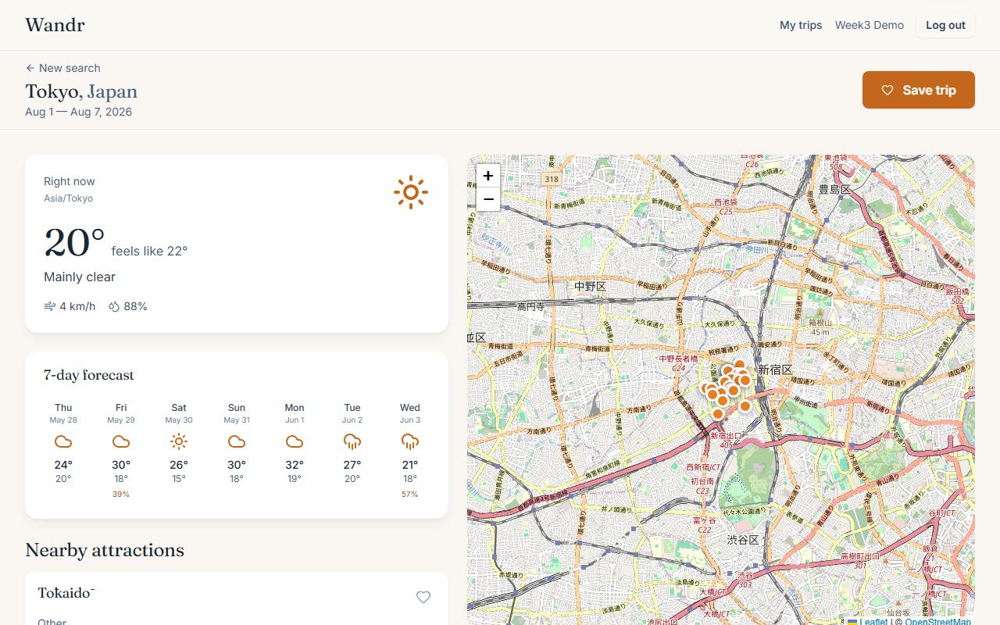

# Wandr — Intelligent Travel Planner

🌍 **Live:** https://wandr-travel-planner-red.vercel.app

Plan your next trip: search any destination, see live weather forecasts and
nearby attractions on an interactive map, and save your favourite trips to
revisit anytime.

---

## Screenshots



---

## Tech Stack

| Layer            | Technology                     |
| ---------------- | ------------------------------ |
| Frontend         | React 18, Vite, Tailwind CSS 3 |
| Routing          | React Router 7                 |
| Backend          | Node.js 22, Express 4          |
| Database         | MongoDB Atlas (Mongoose 8)     |
| Auth             | JWT (jsonwebtoken) + bcryptjs  |
| Maps             | Leaflet.js + react-leaflet 4   |
| Weather          | Open-Meteo API (free, no key)  |
| Attractions      | OpenTripMap API (free tier)    |
| Frontend hosting | Vercel                         |
| Backend hosting  | Render                         |

---

## Features

- **Live weather** — current conditions + 7-day daily forecast for any destination
- **Nearby attractions** — curated sights mapped to where you'll actually be
- **Interactive map** — Leaflet/OpenStreetMap with orange brand markers
- **User accounts** — register, login, JWT auth
- **Save trips** — favourite attractions inline, save to your account, revisit anytime
- **Protected routes** — trip data scoped to the authenticated user

---

## Local Development

### Prerequisites

- Node.js 22+
- MongoDB Atlas account (free) — or a local MongoDB instance
- OpenTripMap API key (free at https://dev.opentripmap.org/product)

### Setup

```bash
# Clone the repo
git clone https://github.com/inka0202/wandr-travel-planner.git
cd wandr-travel-planner

# Install and start the backend
cd server
cp .env.example .env          # fill in your values
npm install
npm run dev                   # runs on http://localhost:5000

# In a second terminal, install and start the frontend
cd ../client
cp .env.example .env          # VITE_API_BASE_URL can stay blank for dev
npm install
npm run dev                   # runs on http://localhost:5173
```

The Vite dev server proxies all `/api/*` requests to `http://localhost:5000` automatically — no
CORS config needed in development.

### Required environment variables

**`server/.env`**

| Variable              | Description                                                                                                  |
| --------------------- | ------------------------------------------------------------------------------------------------------------ |
| `MONGODB_URI`         | MongoDB Atlas connection string                                                                              |
| `JWT_SECRET`          | Min 128 hex chars (generate with `node -e "console.log(require('crypto').randomBytes(64).toString('hex'))"`) |
| `JWT_EXPIRES_IN`      | Token lifetime, e.g. `7d`                                                                                    |
| `CLIENT_ORIGIN`       | Frontend origin, e.g. `http://localhost:5173`                                                                |
| `OPENTRIPMAP_API_KEY` | Free key from dev.opentripmap.org                                                                            |

**`client/.env`**

| Variable            | Description                                                            |
| ------------------- | ---------------------------------------------------------------------- |
| `VITE_API_BASE_URL` | Leave blank in dev (Vite proxy handles it). Set to Render URL in prod. |

---

## Project Structure

```
wandr/
├── client/          # React + Vite frontend (deployed to Vercel)
└── server/          # Express + Mongoose backend (deployed to Render)
```

Each package has its own `package.json` and `node_modules`. No workspace hoisting.

---

## Deployment

- **Backend:** Render Web Service — Root Directory: `server`
- **Frontend:** Vercel — Root Directory: `client`
- **Database:** MongoDB Atlas M0 (free tier)
- **Keepalive:** UptimeRobot pings `/health` every 5 min to prevent Render cold starts
