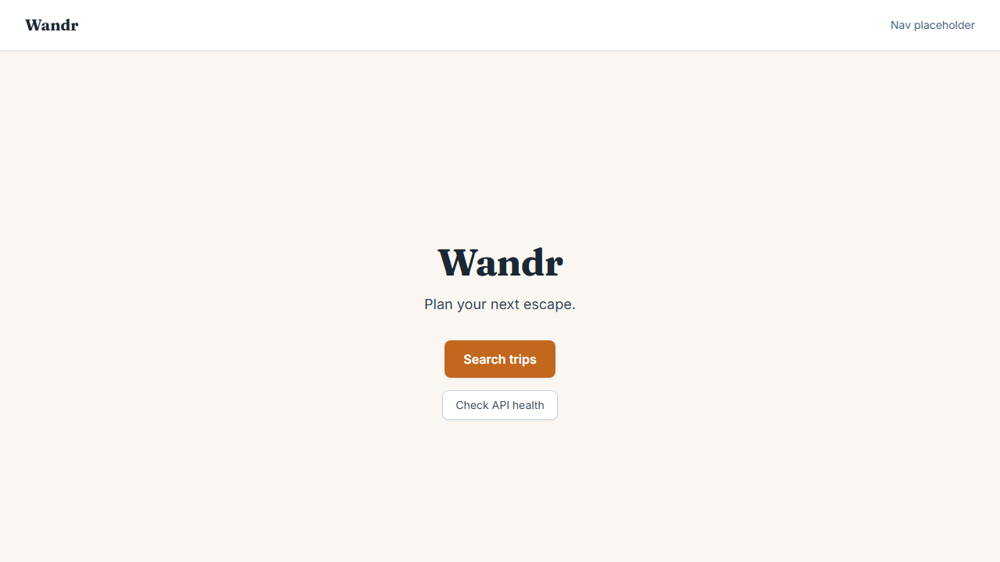

# Wandr — Travel Planner

A full-stack travel planning app built with React + Express + MongoDB. Search destinations, view weather forecasts and nearby attractions on a map, and save trips to your account.



---

## Tech Stack

| Layer | Technology |
|---|---|
| Frontend | React 18, Vite 5, React Router v7, Tailwind CSS v3 |
| Backend | Node 22, Express 4, Mongoose 8 |
| Database | MongoDB Atlas (M0 Free) |
| Auth | JWT — stored in `localStorage`, sent via `Authorization: Bearer` header |
| Maps | Leaflet + React-Leaflet v4 |
| Deployment | Vercel (client) + Render (server) |

---

## Monorepo Structure

```
wandr/
├── client/     # Vite + React — deploys to Vercel
└── server/     # Express + Mongoose — deploys to Render
```

Each package has its own `package.json` and `node_modules`. No workspace hoisting.

---

## How to Run

### Prerequisites

- Node >= 22 (see `.nvmrc`)
- A MongoDB Atlas M0 cluster with a `wandr` database (free — see Atlas setup below)

### 1. Server

```bash
cd server
npm install
cp .env.example .env      # fill in real values (see Environment Variables below)
npm run dev
# ✅ http://localhost:5000
```

### 2. Client

```bash
cd client
npm install
cp .env.example .env.local   # optional — leave VITE_API_BASE_URL blank for dev
npm run dev
# ✅ http://localhost:5173
```

The Vite dev server proxies all `/api/*` requests to `http://localhost:5000` automatically — no CORS config needed in development.

---

## Environment Variables

### Server (`server/.env`)

Copy `server/.env.example` and fill in:

| Variable | Description |
|---|---|
| `NODE_ENV` | `development` or `production` |
| `PORT` | Port for Express (default `5000`) |
| `MONGODB_URI` | Atlas connection string — include `/wandr` database name |
| `JWT_SECRET` | 64-byte random hex string — generate with `node -e "console.log(require('crypto').randomBytes(64).toString('hex'))"` |
| `JWT_EXPIRES_IN` | Token lifetime (default `7d`) |
| `CLIENT_ORIGIN` | Allowed CORS origin — `http://localhost:5173` in dev, your Vercel URL in prod |

### Client (`client/.env.local`)

Copy `client/.env.example`:

| Variable | Description |
|---|---|
| `VITE_API_BASE_URL` | Leave **blank** in dev (Vite proxy handles it). Set to your Render backend URL in prod. |

> **Never commit `.env` files.** Both are in `.gitignore`.

---

## Atlas Setup (quick)

1. [cloud.mongodb.com](https://cloud.mongodb.com) → New Project `Wandr` → Build Database → **M0 Free**
2. Database Access → Add User `wandr_app` with auto-generated password (save it)
3. Network Access → Add IP `0.0.0.0/0` (Render free-tier IPs aren't static)
4. Connect → Drivers → Node.js → copy the `mongodb+srv://...` string
5. Replace `<password>` and append `/wandr` for the database name

---

## Auth Flow

1. **Register / Login** — `POST /api/auth/register` or `POST /api/auth/login` with `{ email, password }`. The server hashes the password with bcryptjs (12 salt rounds) and issues a signed JWT (`exp: 7d`, payload `{ sub: userId }`).
2. **Token storage** — The JWT is stored in `localStorage` under the key `wandr_token`. Every outgoing API request includes `Authorization: Bearer <token>` via an axios request interceptor.
3. **Session restore** — On page load, `AuthContext` checks `localStorage` for a token. If present it calls `GET /api/auth/me` to fetch the current user; if the token is expired or invalid it removes the key and sets `user = null`.
4. **Protected routes** — `/trips`, `/trips/:id`, and `/profile` require authentication. Unauthenticated visitors are redirected to `/login?next=<intended-path>` and returned there after login.
5. **Logout** — `POST /api/auth/logout` (no-op on the server, exists for a future token blacklist) + clears `wandr_token` from `localStorage`.
6. **Token expiry** — Any 401 response fires an `auth:expired` custom event via the axios response interceptor. `AuthContext` listens for this, clears `user`, and the `ProtectedRoute` redirects to `/login`.

---

## Week 1 Milestone

Working front-end and back-end demo with:

- MongoDB Atlas connected, verified health endpoint (`GET /api/health`)
- Two Mongoose schemas: `User` (email + passwordHash + displayName) and `Trip` (embedded attractions)
- React Router v7 with protected routes — `/trips` redirects unauthenticated users to `/login`
- Locked design system: navy-800 / orange-600 / cream palette, Fraunces serif + Inter sans, WCAG AA verified
- `axios` instance with localStorage Bearer token interceptors + `AuthContext` skeleton ready for Week 2 auth
- ESLint 9 flat config + Prettier enforcing consistency on both packages

---

## Week 2 Milestone

Working authentication system:

- `POST /api/auth/register` — bcryptjs hash (12 rounds), JWT issuance, `EMAIL_EXISTS` 409 on duplicate
- `POST /api/auth/login` — bcrypt compare, generic error message (prevents user enumeration), `authLimiter` (5 req / 15 min)
- `GET /api/auth/me` — `verifyJWT` middleware looks up user by `decoded.sub` every request
- `POST /api/auth/logout` — server no-op; client clears `wandr_token` from `localStorage`
- Register and Login pages with React Hook Form (`mode: onBlur`), inline field errors, submit-level error states
- `FormField` component — `forwardRef`, `aria-invalid`, `aria-describedby`, hint/error toggle
- Auth-aware `Navbar` — shows user identity + Log out when authenticated, Log in / Sign up when not; no flash during initial token check
- `ProtectedRoute` redirects to `/login?next=<path>` and returns to intended destination after login
- Token expiry detected server-side (`TOKEN_EXPIRED` 401) and client-side (axios interceptor → `auth:expired` event → user cleared)
